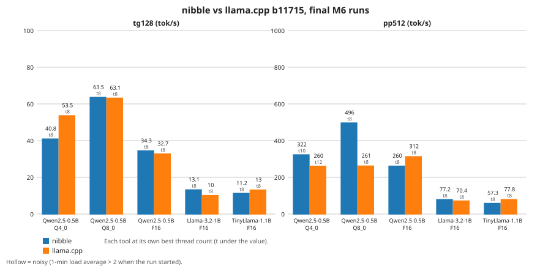
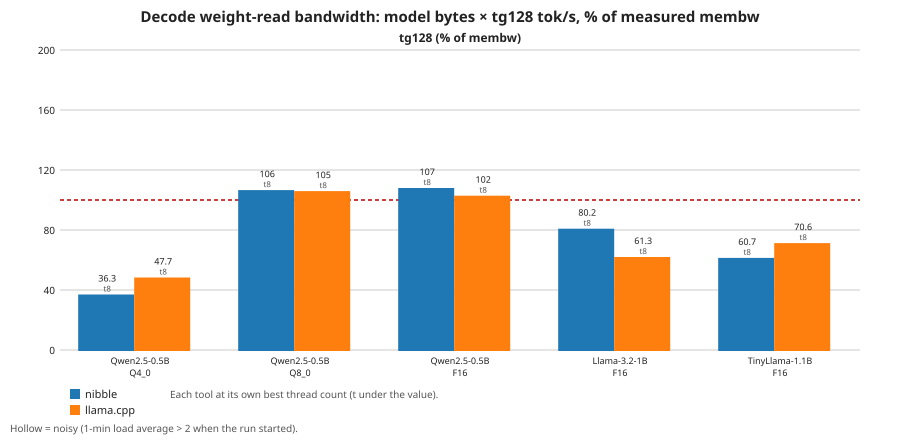
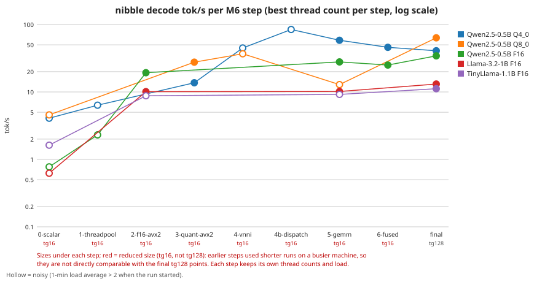

# nibble

nibble is a from-scratch LLM inference engine in C++20. It loads GGUF model
files directly (mmap, no conversion step), implements its own byte-level BPE
tokenizer and transformer forward pass, and is checked against llama.cpp as a
reference. It has no runtime dependencies beyond the C++ standard library and
pthreads.

## Status

Milestones M0–M6 are done: Qwen2.5 (F16, Q8_0, Q4_0), Llama 3.2 1B and TinyLlama
1.1B (F16) run on the CPU with AVX2/AVX-VNNI kernels (scalar twins kept as the
reference) on a thread pool, with a sampler and a multi-turn `nibble chat`. See
[Performance](#performance) for numbers against llama.cpp.

## Supported models

| model | types | how to get it |
|-------|-------|---------------|
| Qwen2.5-0.5B-Instruct | F16, Q8_0, Q4_0 | `tools/download_models.sh` (F16), then `tools/make_quants.sh` (Q8_0, Q4_0) |
| Llama-3.2-1B-Instruct | F16 | `tools/convert_hf.sh llama32-1b` |
| TinyLlama-1.1B-Chat-v1.0 | F16 | `tools/convert_hf.sh tinyllama-1.1b` |

`convert_hf.sh` downloads the Hugging Face weights at a pinned commit, checks
every file against the hashes the Hugging Face API lists for that commit, and
converts them offline with the pinned llama.cpp converter. It refuses repos whose
config could make the converter run repo code (`auto_map`, or an unexpected
`tokenizer_class`). `nibble chat` picks the chat format from the model's chat
template: ChatML (Qwen2.5), Llama 3 header format (Llama 3.2) or Zephyr
(TinyLlama). The Llama 3.2 prompt carries the official template's default
knowledge-cutoff and date lines, and trims system and user text as that template
does.

Changes for Qwen since M4: a given `--seed` now gives different output than in
M4, because each reply derives its own seed; generation also stops on `</s>` and
the FIM pad, repo-name and file-separator tokens, as in llama.cpp; and with
special parsing, `</s>` is now a control token.

## Build

```sh
cmake -S . -B build -DCMAKE_BUILD_TYPE=Release && cmake --build build -j
```

Requires CMake ≥ 3.25 and g++ 13 or clang 18. Catch2 is fetched at configure time.

## Getting a model

```sh
tools/download_models.sh   # downloads qwen2.5-0.5b-instruct-fp16.gguf into models/
tools/make_quants.sh       # makes the Q8_0 and Q4_0 models from it (needs the llama.cpp build)
```

## Usage

```sh
build/nibble info models/qwen2.5-0.5b-instruct-fp16.gguf
build/nibble run -m models/qwen2.5-0.5b-instruct-fp16.gguf -p "The capital of France is" -n 32
build/nibble chat -m models/qwen2.5-0.5b-instruct-q4_0.gguf
```

`nibble info <model.gguf>` prints the GGUF metadata and tensor table.

`nibble run` flags:

| flag | meaning |
|------|---------|
| `-m <model.gguf>` | model file (required) |
| `-p <prompt>` | prompt text (exactly one of `-p` / `-f`) |
| `-f <file>` | read the prompt from a file |
| `-n <N>` | maximum tokens to generate (default 256) |
| `-t <N>` | worker threads (default: see [Default thread count](#performance)) |
| `-c <N>` | context length (default: min(4096, model context)) |
| `--temp <f>` | sampling temperature, >= 0; 0 is greedy (default 0.8) |
| `--top-k <N>` | top-k cutoff; 0 disables (default 40) |
| `--top-p <f>` | nucleus cutoff in (0, 1] (default 0.95) |
| `--seed <u64>` | sampler seed (default: random); each reply draws its own stream, derived from the seed and the reply's index, so a seeded `chat` is reproducible and its turns are not correlated |

Sampling order is top-k, then temperature-scaled softmax, then top-p. llama.cpp's
default chain is top-k, top-p, min-p (0.05), temperature, so the same flag values
select a different nucleus there.

Text streams to stdout; a stop reason and timing line go to stderr. Bad flag
values print usage and exit 2; errors such as a missing model exit 1.

`nibble chat -m <model.gguf> [--system <text>] [-n N] [-t N] [-c N]` plus the
sampling flags reads one user message per stdin line and streams each reply to
stdout (`-n` is per reply, default 512). Blank lines are skipped. It prompts with
`> ` on stderr only when stdin is a terminal, stops at EOF, and on a full context
prints `[context full]` and exits 0.

`nibble bench -m <model.gguf> [-t 1,2,4] [-p 512] [-n 128] [-r 5] [--mem] [--out f.jsonl]`
measures prefill (`pp<p>`) and decode (`tg<n>`) tok/s per thread count (median, min,
max over `-r` reps after one warm-up); `--mem` adds a memory-bandwidth probe (GB/s means
1e9 bytes per second). `--out` appends one JSON line per measurement (delete the file
to start fresh); each line carries `"kernels"`, the same string `nibble info` prints
(`avx2+fma+f16c+avxvnni`, `avx2+fma+f16c` or `scalar`); rows without the field predate it and are
scalar. `nibble bench --version` prints the baked-in git SHA (`-dirty` if
tracked files differ from HEAD). `tools/bench_llamacpp.sh <model> <threads>
<out.jsonl>` (env `P`, `N`, `R` override prompt tokens=512, gen tokens=128, reps=5; it also appends) produces the same schema from llama.cpp's `llama-bench`. Results live in
`bench/results/`.

## Tests

```sh
ctest --test-dir build -LE e2e
```

End-to-end tests compare against llama.cpp. They need the model, a pinned
llama.cpp build, and golden files:

```sh
tools/build_llama_cpp.sh && tools/build_llama_cpp.sh --generic && tools/make_quants.sh \
  && for m in f16 q8_0 q4_0; do tools/make_golden.sh qwen2.5-0.5b-$m; done \
  && ctest --test-dir build -L e2e
```

## Correctness

Against llama.cpp on Qwen2.5-0.5B-Instruct F16:

- Tokenizer: 37/37 corpus cases tokenize exactly as llama.cpp does, and so do
  5/5 special-parsing cases on all five models.
- Logits: minimum cosine similarity 0.99996 over all positions.
- Greedy decoding: 64/64, 64/64 and 46/64 tokens match on the three e2e prompts.
  The third diverges at a near-tie, where an fp64 reference implementation agrees
  with nibble.

Q8_0 and Q4_0 (made with `llama-quantize --pure`) are compared against a
generic-path llama.cpp build (no SIMD, llamafile or weight repack) with an F32 KV
cache. The gate is looser than for F16: cosine >= 0.995 at every position and on
the prefill last row, and top-1 agreement on >= 90% of positions per prompt
(near-ties count as agreement). Greedy decoding is reported but not asserted.
Activation requantization amplifies rounding-level differences: nibble, generic
llama.cpp and an fp64 oracle with Q8_0 requantization disagree pairwise at about
0.9966 cosine, so a tighter gate was not attained by any of the three
implementations compared. Minimum cosine (capital / code / chat):

- Q8_0: 0.999425 / 0.998160 / 0.998035
- Q4_0: 0.999297 / 0.998525 / 0.997295

These move with rounding-level changes and were re-recorded in M6: when the
scalar oracle stopped contracting FMAs (`-ffp-contract=off`), and again when
RMSNorm, SiLU and attention got SIMD kernels.

Llama-3.2-1B-Instruct and TinyLlama-1.1B-Chat F16 (same strict gate as Qwen F16:
cosine >= 0.999 at every position, argmax agreement except near-ties, greedy
divergence only at a near-tie). Minimum cosine (capital / code / chat):

- Llama 3.2 1B: 0.999996 / 0.999981 / 0.999990; top-1 agreement 100%; greedy 64/64 on all three
- TinyLlama 1.1B: 0.999999 / 0.999999 / 0.999997; top-1 agreement 100%; greedy 64/64 on all three

## Performance

All numbers come from `bench/results/*.jsonl`; the charts and the tables below are
generated from them by `bench/plot.py` (`bench/plot.py` writes `docs/bench/*.svg`,
`bench/plot.py --markdown` prints the tables).

**Machine:** Intel Core i7-1265U (2 P-cores with Hyper-Threading plus 8 E-cores, 12
logical CPUs; AVX2, FMA, F16C, AVX-VNNI), under WSL2 on a shared laptop. g++ 13
Release build of commit `2ca56ef`; llama.cpp b11715 (`tools/bench_llamacpp.sh`).

**Protocol:** `nibble bench -p 512 -n 128 -r 5` and `llama-bench` with the same
sizes and thread count: median of 5 reps after 1 warm-up. For each (model, thread
count) the two tools ran back to back in one session, with alternating order so
neither always runs second on a hot CPU. Before each tool run the driver waited
45 s and then until the 1-minute load average was below 2 (at most 10 minutes). Each row records
the load average when it started; rows above 2 count as noisy (hollow in the
charts, † in the tables). None of the final rows is noisy. Qwen2.5-0.5B Q4_0 was swept over
t = 1, 2, 4, 6, 8, 10, 12; the other models ran at t = 1 and 8. The machine is
shared, so run-to-run spread is large: the sweep is not monotonic (llama.cpp
tg128 is 47.3 at t = 2 but 41.6 at t = 4), and differences under about 10% are
within the noise.

**Target (tg128 on Qwen2.5-0.5B Q4_0 within 1.5× of llama.cpp): met, not matched.**
Both tools are fastest at t = 8: llama.cpp 53.5 tok/s, nibble 40.8, a ratio of
1.31×. At t = 1 the ratio is 1.42× (27.4 vs 19.3). On pp512 nibble is faster at every
thread count of the sweep (322 tok/s at t = 10 vs llama.cpp's best, 260 at
t = 12). Of the other models, nibble's decode is level with llama.cpp on Qwen
Q8_0 and F16 (within the noise), faster on Llama 3.2 1B F16 and slower on TinyLlama
1.1B F16.

| model | test | nibble, best t | llama.cpp, best t | llama.cpp ÷ nibble | llama.cpp at nibble's t | ÷ nibble, same t | nibble weight BW |
|---|---|---|---|---|---|---|---|
| Qwen2.5-0.5B Q4_0 | tg128 | 40.8 (t8) | 53.5 (t8) | 1.31× | 53.5 (t8) | 1.31× | 36% of membw |
| Qwen2.5-0.5B Q4_0 | pp512 | 322.1 (t10) | 260.0 (t12) | 0.81× | 189.8 (t10) | 0.59× |  |
| Qwen2.5-0.5B Q8_0 | tg128 | 63.5 (t8) | 63.1 (t8) | 0.99× | 63.1 (t8) | 0.99× | 106% of membw |
| Qwen2.5-0.5B Q8_0 | pp512 | 495.8 (t8) | 260.9 (t8) | 0.53× | 260.9 (t8) | 0.53× |  |
| Qwen2.5-0.5B F16 | tg128 | 34.3 (t8) | 32.7 (t8) | 0.95× | 32.7 (t8) | 0.95× | 107% of membw |
| Qwen2.5-0.5B F16 | pp512 | 260.3 (t8) | 312.0 (t8) | 1.20× | 312.0 (t8) | 1.20× |  |
| Llama-3.2-1B F16 | tg128 | 13.1 (t8) | 10.0 (t8) | 0.76× | 10.0 (t8) | 0.76× | 80% of membw |
| Llama-3.2-1B F16 | pp512 | 77.2 (t8) | 70.4 (t8) | 0.91× | 70.4 (t8) | 0.91× |  |
| TinyLlama-1.1B F16 | tg128 | 11.2 (t8) | 13.0 (t8) | 1.16× | 13.0 (t8) | 1.16× | 61% of membw |
| TinyLlama-1.1B F16 | pp512 | 57.3 (t8) | 77.8 (t8) | 1.36× | 77.8 (t8) | 1.36× |  |

Thread sweep, Qwen2.5-0.5B Q4_0 (tok/s):

| t | nibble tg128 | llama.cpp tg128 | nibble pp512 | llama.cpp pp512 |
|---|---|---|---|---|
| 1 | 19.3 | 27.4 | 143.6 | 93.6 |
| 2 | 27.4 | 47.3 | 216.3 | 149.0 |
| 4 | 39.5 | 41.6 | 272.7 | 189.5 |
| 6 | 36.8 | 43.3 | 243.2 | 221.2 |
| 8 | 40.8 | 53.5 | 290.5 | 231.3 |
| 10 | 30.5 | 37.3 | 322.1 | 189.8 |
| 12 | 31.0 | 40.5 | 321.1 | 260.0 |

† noisy: 1-minute load average > 2 when the run started.



**Roofline.** Decode reads every weight once per token, so `model bytes × tg128
tok/s` is the weight-read bandwidth it achieves (the GGUF file size stands in for
the weight bytes). `roofline.svg` shows it as a percentage of `nibble bench --mem`
at the same thread count. That probe is a plain streaming sum and does not reach the
machine's peak: Q8_0 and F16 decode exceed it slightly (106% and 107%), so those
models are memory-bound; Q4_0, at 36%, is still compute- or overhead-bound.



**Ladder.** `ladder.svg` shows nibble's best decode tok/s after each M6 step
(`bench/results/m6-*.jsonl`). Each step keeps its own thread counts and load
average. All steps except the last used reduced sizes (tg16, labelled under each step) on a
busier machine, so they show the trend, not exact speed-ups. The hand-recorded
thread-pool dispatch timings in `m6-4b-dispatch.jsonl` are not plotted.



**Default thread count.** With `n_threads = 0` (and no `-t` for `run` and
`chat`) nibble reads `/sys/devices/system/cpu/cpu*/cpu_capacity`. If the
capacities differ (a hybrid CPU), it uses the CPUs at the highest capacity. Otherwise it uses
2/3 of `hardware_concurrency`, which is 8 here: the best tg128 thread count in
the sweep above. WSL2 reports a capacity of 1024 on all 12 CPUs, and a
topology of 6 cores with 2 threads each, which is not the real 2 P + 8 E. So on
this machine the rule always takes the 2/3 fallback. The hybrid branch has not
been measured on native Linux. `nibble bench -t` still defaults to 1.

## Roadmap

Done: M4 Q8_0/Q4_0, sampler, chat · M5 Llama 3.2 and TinyLlama · M6 SIMD
kernels, threading and benchmarks. Next: Phase 2: CUDA backend.

## License

MIT; see [LICENSE](LICENSE).
